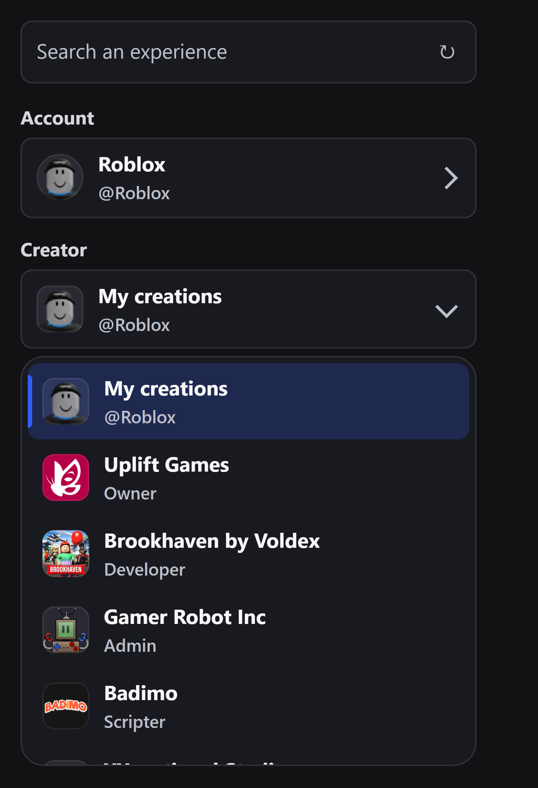
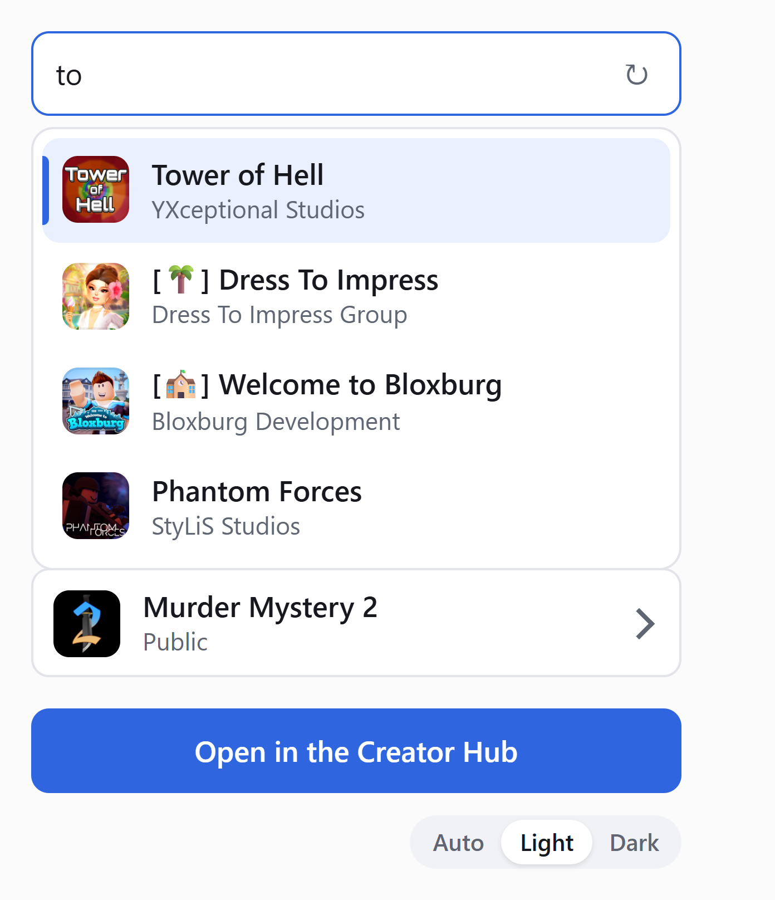

# rbx-creator-switch

[](https://github.com/rbx-dev-tools/rbx-creator-switch/actions/workflows/ci.yml)
[](./LICENSE)

A Chrome extension that picks a Roblox account, then a creator, then one of
that creator's experiences, in a single popup.

The Creator Hub spreads that same choice over three places: the profile menu in
the top right for the account, the menu on the left for the creator, and the
grid for the experience. Each row here carries its picture, because a list of
thirty names makes you read where a list of icons lets you recognise.

<p align="center">
  
  
</p>

> **Not affiliated with Roblox, and built on endpoints Roblox does not
> document.** They can change without notice, and when they do this extension
> stops working until it is updated. What they are, how they were measured, and
> what breakage will look like is in
> [docs/creator-hub-api.md](docs/creator-hub-api.md). If something stopped
> working, [open an issue](https://github.com/rbx-dev-tools/rbx-creator-switch/issues/new/choose)
> with the text of the status line.

## Install

Not on the Chrome Web Store yet. Download the zip from the
[latest release](https://github.com/rbx-dev-tools/rbx-creator-switch/releases/latest)
and unpack it, or clone this repository. Then open `chrome://extensions`, turn
on Developer mode, choose "Load unpacked" and pick the folder. Chrome 95 or
later; the manifest refuses older ones.

An unpacked extension does not update itself: when a release fixes an endpoint
Roblox changed, download it again and press the reload arrow on
`chrome://extensions`. To work on the code, use `npm run dev` below instead.

Firefox is untested. The code uses only the promise-based `chrome.*` APIs
that Firefox's MV3 supports, and it already handles host permission being
withheld, which is Firefox's default, so it may work with a
`browser_specific_settings` entry in the manifest. Reports welcome.

## Keyboard

`Ctrl+Shift+Y` opens it, and the cursor starts in the search field, so the
whole path is: shortcut, type a name, Enter.

A suggested shortcut is only that. Chrome assigns it when the extension is
first installed, silently drops it if another extension already holds the
combination, and refuses some combinations outright: `Alt+Shift+R` was the
first choice here and Chrome assigned nothing at all, even on a clean profile,
which is measurable through `chrome.commands.getAll()`. If the shortcut does
nothing, `chrome://extensions/shortcuts` is where to see what it actually got
and to set your own. An extension that was already installed before this key
existed keeps whatever it had, so it has to be set there by hand.

Inside the popup: arrows move through a list, Enter takes the highlighted row,
Escape closes it.

## What it can and cannot do

Worth reading before installing it, and before handing it to someone else.

**It never sees your cookies.** The `cookies` permission is not requested, so
`chrome.cookies` does not exist for it. Its requests are sent with
`credentials: "include"`, which asks the browser to attach the session cookie
itself; the value never passes through any code in this repository.

**It never leaves roblox.com.** It sends requests to two hosts,
`apis.roblox.com` and `thumbnails.roblox.com`, and opens tabs on two more,
`www.roblox.com` and `create.roblox.com`. That is the complete list:
`grep -rn "https://" src/` prints it on one screen, and `npm run check` fails
when the code names a host this paragraph does not. No telemetry, no
analytics, no remote configuration, no remote code.

**It declares two permissions**, `scripting` and `storage`, plus host access to
`https://*.roblox.com/*`. Nothing prompts you: a manifest permission is granted
when the extension is installed, and loading unpacked shows no dialog at all.
That is exactly why the list is worth reading rather than waiting to be asked
about. There is deliberately no `tabs` permission: with it,
an extension can read the URL and title of every open tab, and it turned out to
be unnecessary, since host access already allows finding a roblox.com tab and
reading its URL. `npm run check` fails the build on a declared permission
nothing calls, so that list cannot quietly grow.

**It reads one thing that is not public**: `localStorage.RBXASBlob` on
`www.roblox.com`, the record of which accounts are signed in. It is sent to the
same Roblox endpoint the site itself sends it to, and nowhere else. It is
written back only after a switch you asked for, never after a read, so this
extension never competes with the page over which version of that record wins.

**What it stores** is a per-account cache of your creator and experience lists,
plus your theme choice, in `chrome.storage.local`, on your machine.

**It needs a roblox.com tab**, because the session cookies and the account
switcher state only exist there. It uses one you already have open. If there
is none, it opens `www.roblox.com/home` in the background and closes it again
when the popup closes, unless you brought that tab to the front in between, in
which case it is yours and stays.

**Names coming from Roblox are written as text, never as markup**, so a group
or experience named after a `<script>` tag is displayed, not executed.

## Development

```bash
npm install
npm run dev
```

That opens Chrome with this folder installed, reinstalls it on every save, and
refreshes any open roblox.com tab so no content script keeps running against
the previous version. Ctrl+C closes it.

It uses its own persistent profile, which keeps the debugging port out of your
everyday browser and makes signing in to Roblox there a one-off. The trade is
that the dev window has none of your other extensions. `CHROME` sets the
browser binary, `DEV_PROFILE` the profile location (default
`~/.rbx-creator-switch/profile`), `CDP_PORT` the port.

```bash
npm run demo           # the popup in a plain tab, on stand-in data, at http://127.0.0.1:8765/
npm run screenshots    # the same, captured to docs/screenshots/: README views and 1280x800 store pictures
npm run check          # does this extension still hold together
npm run icons          # re-render icons/*.png from icons/icon.svg
npm test               # node --test
npm run lint           # eslint
npm run format         # prettier
```

`npm run demo` serves the popup with a stand-in for `chrome.*` that answers
from well-known public experiences, so the layout can be looked at, and the
README pictures taken, without a Roblox session. Nothing of it ships: the
extension's own files run unchanged, only the browser they talk to is fake.

`npm run check` walks the manifest, the popup markup, the module imports and
the `chrome.scripting` calls, and asserts every path they name exists, that no
shipped file is unreferenced, and that no declared permission is unused. A
moved file is invisible to a linter and surfaces as `ERR_FILE_NOT_FOUND` when a
browser opens the popup. `lefthook install` runs the same checks before a
commit.

### Why a script and not a folder

Chrome has no drop-in folder for extensions, the way Roblox Studio watches its
Plugins directory, and cannot have one: the list of installed extensions lives
in the profile's `Secure Preferences` under an HMAC, so a folder dropped into
`Extensions/` is unsigned and discarded. That check is what stops malware from
adding an extension behind your back.

Measured on Chrome 151: `--load-extension` is ignored, alone and alongside
`--disable-extensions-except`. The DevTools protocol command
`Extensions.loadUnpacked` works, and called again on the same path it returns
the same extension id, which makes it a reload in place. That is what
`scripts/dev.mjs` drives, and why it starts its own browser: the debugging port
can only be opened at launch, so a Chrome that is already running cannot be
targeted.

## How it is put together

| File                                  | Role                                                                                              |
| ------------------------------------- | ------------------------------------------------------------------------------------------------- |
| `manifest.json`                       | MV3 manifest                                                                                      |
| `src/agent.js`                        | Injected into a roblox.com tab. Every Roblox call lives here: CSRF, the switcher blob, thumbnails |
| `src/popup/popup.html`, `popup.css`   | The shell and the design tokens                                                                   |
| `src/popup/main.js`                   | Wiring: an account owns creators, a creator owns experiences                                      |
| `src/popup/client.js`                 | Finds a usable roblox.com tab, injects the agent, runs one request                                |
| `src/popup/picker.js`                 | One dropdown with a picture per row. Knows nothing about Roblox                                   |
| `src/popup/cache.js`                  | What to paint before the answer arrives                                                           |
| `src/popup/status.js`                 | The status line, and the guard that routes failures to it                                         |
| `src/popup/theme.js`                  | Light, dark or auto                                                                               |
| `scripts/dev.mjs`                     | Dev launcher and reloader. Not part of the shipped extension                                      |
| `scripts/check.mjs`                   | The coherence check described above                                                               |
| `icons/icon.svg`, `scripts/icons.mjs` | The icon, and the command that renders it to the PNG sizes Chrome wants                           |

The popup runs on the extension origin, which can neither read roblox.com's
storage nor send its cookies, so all the work happens in the injected agent.
The requests are made from the content script rather than a service worker on
purpose: from the worker the request origin changes and the CSRF handshake gets
harder to satisfy.

The agent is re-injected on every request rather than left listening. An
injected script outlives the extension version that put it there, so a listener
registered before a reload would keep answering with the shapes it used to
return: an extension that looks alive and is wrong.

A tab qualifies only once its document is really the roblox.com one. `tab.url`
says where a tab is going, not what it holds, so a tab still committing its
navigation, or one Chrome unloaded to save memory, reports roblox.com while its
live document is still `about:blank`.

Lists are painted from the last known answer before the real one arrives, but
the request always goes out, and pictures are fetched after the names rather
than before them. An icon its owner changed this morning shows up on this open,
right after the stale one.

Crucially, no step waits on the previous step's revalidation. The cache answers
`peek`, the screen updates, and the refresh runs behind. Measured on a real
account: the switcher answers in about 130ms, the group list in 190ms and the
experience search in 300ms, so a chain that awaited each in turn spent over
half a second changing account with every list already cached.

## Search

Type a name into the field at the top and the popup finds the experience
wherever it lives, filling in the account and the creator that reach it.

There is no server-side search to lean on: measured, `universes/v1/search`
ignores `Keyword`, `SearchQuery`, `Query` and `UniverseName`, and answers `401`
without a creator. So the popup holds its own catalogue, one request per
creator, built on the first search and then kept. The circular arrow next to
the field rebuilds it; a list of experiences moves far more slowly than the
number of times you look through it, so rebuilding is a decision, not a
schedule. A crawl interrupted by the popup closing resumes where it stopped.

When several results answer to the same name:

- **Two creators, same name.** A universe belongs to exactly one creator, so
  these are genuinely two different experiences. Both are listed, each showing
  its creator and its own icon, which is what tells them apart.
- **Two accounts, same universe.** Two of your accounts can be in the same
  group, which lists that group's experience under each of them. That is one
  destination reached two ways, so it is folded into a single row, keeping the
  account that needs no switch.
- **A result from another account** is still offered, marked `switches`, and
  choosing it switches account before opening.

Matches on a prefix are ranked above matches in the middle, and the active
account is listed first.

## Ordering

- **Accounts**, in the order the switcher returns them, with the active one
  preselected.
- **Creators**: your own creations first, then groups alphabetically. Measured:
  the endpoint happens to answer alphabetically today, and the popup sorts
  anyway so that it keeps doing so if the endpoint stops.
- **Experiences**, most recently updated first. That order is applied by the
  server, from the sort this extension asks for.

## Troubleshooting

**"Cannot access contents of the page."** Two different causes wear the same
message. Either the host permission is withheld, which Chrome does when site
access is set to "On click" from `chrome://extensions`, and the popup asks for
it back when it notices. Or the tab is not yet showing the page it says it is,
which the popup now waits out.

**`ERR_FILE_NOT_FOUND` when opening the popup.** The loaded copy points at a
path that has moved. Reload the extension from `chrome://extensions`; a
manifest change always needs that.

**Only the active account in the switcher.** That record lives in
`localStorage` on `www.roblox.com`, so a browser profile that has never signed
in there has no record of the others. Sign in once in that profile.

## Releasing

[docs/publishing.md](docs/publishing.md): the store listing text, the
permission justifications, and how a tag becomes a GitHub release and a
Chrome Web Store update.

## Contributing

Open an issue first, the scope is still moving.
[CONTRIBUTING.md](CONTRIBUTING.md) covers the setup, the house style and how to
work against an undocumented API. Security reports go through
[private advisories](SECURITY.md), not public issues.

## Contact

Bugs and ideas go in [issues](https://github.com/rbx-dev-tools/rbx-creator-switch/issues).
For anything that should not be public, <bap.extensions@gmail.com>, or a
[private security advisory](https://github.com/rbx-dev-tools/rbx-creator-switch/security/advisories/new).

## License

MPL-2.0. See [LICENSE](LICENSE).
